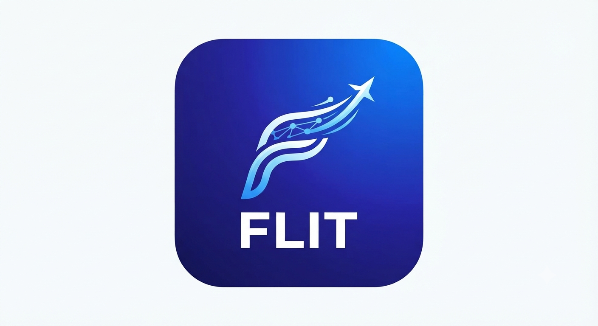
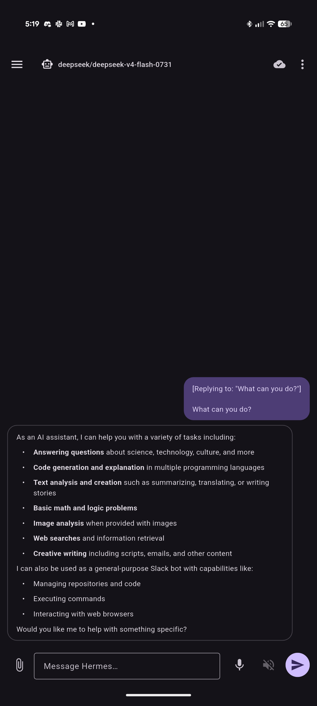
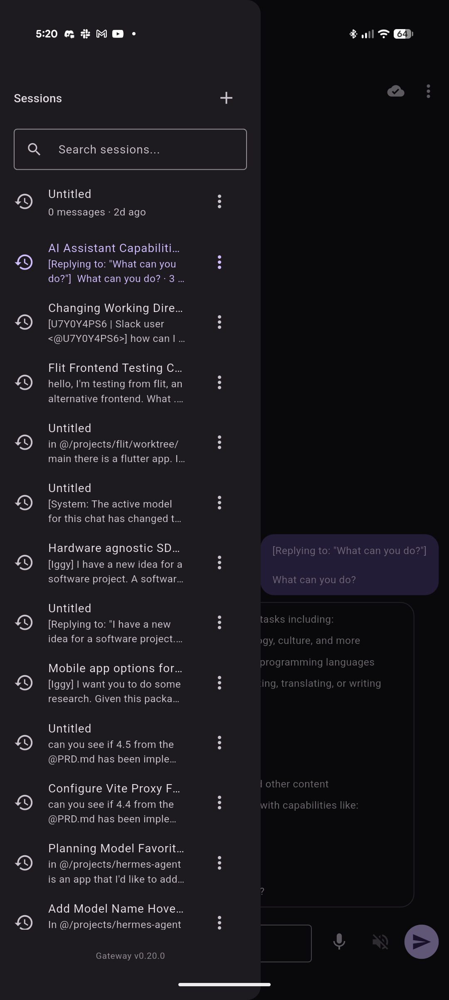
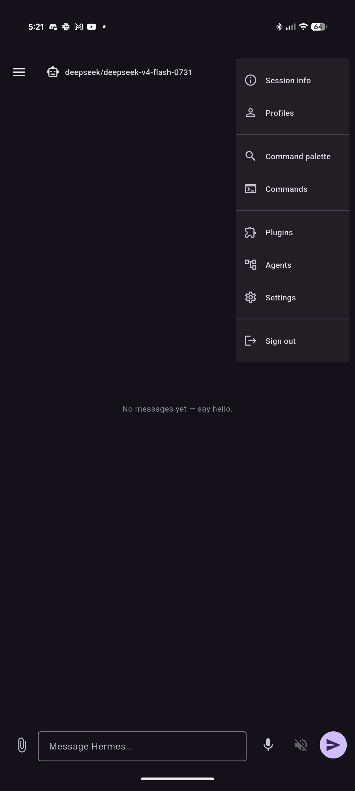
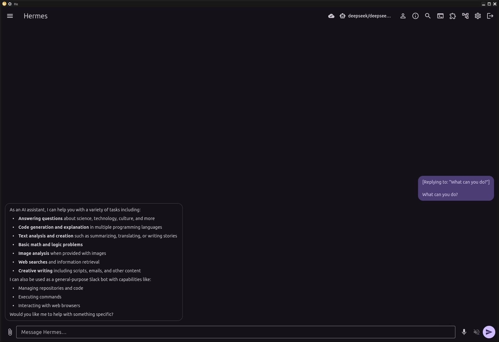
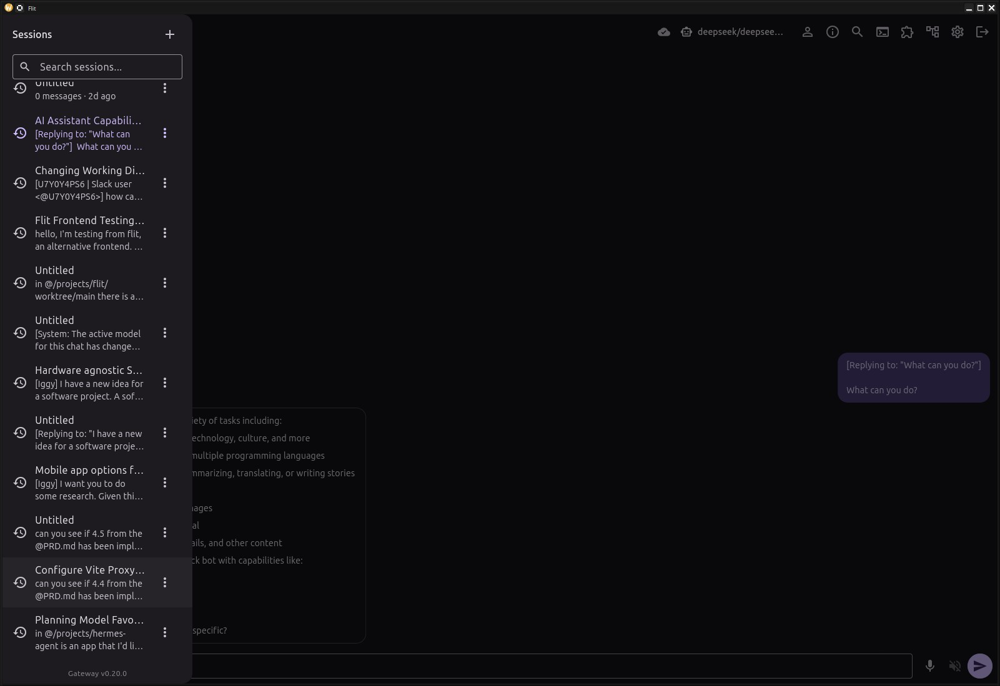

<p align="center"></p>

# flit

**A coding agent you host yourself, that you can reach from any device.**

flit runs an AI coding agent on your own machine, with whatever model you
choose (a local one on your GPU, or a cloud one), and gives you a native app
for your phone, tablet and desktop to talk to it. Start a task at your desk,
answer its questions from the couch.

<p align="center">
  
  
  
</p>
<p align="center">
  
  
</p>

> **Status: early (0.0.x).** Expect rough edges and changes between
> releases. App builds are unsigned (see [Install](#install)).

**On this page:** [Features](#features) · [Use cases](#use-cases) ·
[Install](#install) · [Quick start](#quick-start) · [Configuration](#configuration) ·
[Integrations](#integrations) · [Safety](#safety-and-privacy) ·
[Command reference](#command-reference) · [More docs](#more-docs)

## Features

**Bring your own model**
- Works with any OpenAI-compatible endpoint: llama.cpp, vLLM, Ollama, OpenAI,
  OpenRouter and more. Configure several at once and switch per session.
- Models are discovered automatically (context window, tool and reasoning
  support). Favorites and recents sync across your devices.
- Reasoning effort, model and role can all change mid-session.
- Extra care for local models: llama.cpp prompt-cache reuse, per-model
  concurrency limits, "Answer now" to cut thinking short.

**One conversation, every device**
- Native app for Android, iOS, macOS, Windows and Linux, plus a web build.
- Pair a phone by scanning a QR code. Every device sees the same live
  conversation, and any of them can answer a permission prompt.
- Everything a session does is logged, so reconnecting never loses anything.

**A real agent, not just chat**
- Reads, searches, edits and patches files; runs shell commands; uses git
  (status, diff, log, commit; it never pushes); fetches web pages; searches
  the web through your own SearXNG.
- Sees compile errors right after it edits, through your installed language
  servers (Go, Rust, Python, TypeScript, C/C++ built in).
- Keeps a visible todo list, and hands side tasks to **subagents** so its own
  context stays small.
- Long conversations are **compacted** automatically; nothing is deleted.
- Keep typing while it works: messages queue and join at its next step.
- **Retry** or **edit** any earlier message to branch the conversation.

**Control and safety**
- Shell commands run without asking only when they are on your allow list or a
  built-in read-only list. Everything else prompts you. Deny rules always win.
- Optional small model rates commands before you're asked. "Allow for this
  session", and a yolo mode when you want it.
- Each session can get its own **git worktree and branch**, and a **Changes
  view** shows every file the agent touched, with diffs.

**Extensible**
- **Roles** (`pm`, `qa`, `backend-dev`, `frontend-dev`, or your own) set the
  system prompt, model and memory per task.
- **MCP servers**, local or remote, including ones that need OAuth sign-in.
- **Skills** in the open [Agent Skills](https://agentskills.io) format, from
  your repo or globally.
- **Projects** group sessions by directory.

**Automation**
- **Cron jobs** run prompts on a schedule, unattended.
- **GitHub webhooks** start a session when a PR is opened or an issue filed.
- **ntfy** notifications tell you when a run needs you.

**Learns from you**
- Plain-Markdown **memory** at user and project level, injected into prompts.
  flit proposes lessons after a session; nothing is saved until you approve.
- Rate replies, then **export** sessions as JSONL (OpenAI chat format, with
  redaction) to build your own fine-tuning or eval data.

## Use cases

- **Code from your phone against your own GPU.** Run llama.cpp on a home
  machine, flit next to it, and drive both from the app anywhere you can
  reach the server.
- **Plan, then build, in one session.** Start as `pm` to scope the work,
  switch to `backend-dev` to implement, then `qa` to review.
- **Morning briefing.** A cron job checks CI on `main` and open PRs at 8:30 on
  weekdays and notifies you (via ntfy) if something is red.
- **First-pass PR review.** A GitHub webhook starts an unattended review
  session whenever a PR opens; you read its verdict instead of the diff.
- **Research from anywhere.** Use Share → flit in your browser to drop a URL
  or text into a new session, then say what to do with it.
- **Try risky changes safely.** Turn on worktrees: each session works on its
  own branch and your checkout is never touched.
- **Connect your tools.** Add an MCP server for your tracker or docs, or drop a
  skill into `.agents/skills/` so the agent knows your team's process.
- **Build a dataset.** Rate good turns as you go, then `flit export --rating
  good --redact` for training or evaluation.

## How it fits together

```
 phone / tablet / desktop app ──┐
                                ├──►  flit server  ──►  your model(s)
 other devices ─────────────────┘   (runs the agent,    llama.cpp, Ollama,
                                     tools, sessions)    OpenAI, OpenRouter…
```

The **server** (`flit serve`) is a single static binary that runs the agent
and keeps all state in one data folder. The **app** is a front end for it.
Your code and session history stay on the machine running the server.

## Install

You need two things: the server, on the machine that has your code, and the app,
wherever you want to chat.

### 1. The server

Download the server archive for your platform from the
[latest release](https://github.com/iggy/flit/releases/latest)
(`flit-server-<version>-<os>-<arch>`, for Linux, macOS and Windows on amd64 and
arm64), unpack it, and put the `flit` binary somewhere on your `PATH`.
It has no dependencies (no cgo, no runtime). Check it works:

```sh
flit version
```

You also need `git` on the server's `PATH` for the git tools and Changes view,
and a model endpoint to talk to (see [Models](#models)).

<details>
<summary>Build from source instead</summary>

Requires Go (the version in [`server/go.mod`](server/go.mod)).

```sh
git clone https://github.com/iggy/flit.git
cd flit/server
CGO_ENABLED=0 go build -trimpath -o flit ./cmd/flit
```

</details>

### 2. The app

Download from the [latest release](https://github.com/iggy/flit/releases/latest):

| Platform | File | Notes |
|---|---|---|
| Android | `flit-<version>-android.apk` | Sideload. Android blocks plain-HTTP servers by default, so use HTTPS for phones. |
| iOS | `flit-<version>-ios-unsigned.zip` | Unsigned app bundle. You must sign and install it yourself (e.g. with your own developer account); it isn't on the App Store. |
| macOS | `flit-<version>-macos.dmg` | Not notarized: right-click → Open the first time. |
| Windows | `flit-<version>-windows-x64.zip` | Unzip and run. SmartScreen may warn, since the build is unsigned. |
| Linux | `flit-<version>-linux-x86_64.AppImage`, `flit-<version>-linux.deb`, or `flit-<version>-linux-x64.zip` | AppImage: `chmod +x` and run. |
| Web | `flit-<version>-web.zip` | Static files for any web host. |

## Quick start

**1. Start the server.**

```sh
flit serve
```

On first run flit writes a commented config, creates its data folder, and
prints your admin API token **once** (print it again any time with `flit token`).

**2. Point it at a model.** Open the config file (see
[Configuration](#configuration) for where) and add a provider. Changes apply
immediately, no restart.

```yaml
providers:
  - name: local
    base_url: http://localhost:8080/v1     # e.g. llama.cpp's llama-server
agent:
  provider: local
  model: qwen3-coder
```

**3. Pair the app.**

```sh
flit pair
```

This prints a QR code, the server URL and a one-time code. In the app, choose
**flit** on the connect screen, then scan the QR code (phone) or type the URL
and code (desktop). Codes work once and expire after 10 minutes.

**4. Start a session.** Create a project from a directory on the server (or
use the default *Scratch* project), start a session, and describe what you
want done.

### Pairing and remote access

By default flit listens on `127.0.0.1:7433`, reachable only from the server
machine. To use it from a phone or another computer:

```yaml
listen: 0.0.0.0:7433
public_url: https://flit.example.com    # what devices should connect to
tls:                                     # or terminate TLS in a reverse proxy
  cert_file: /path/to/fullchain.pem
  key_file: /path/to/privkey.pem
```

Use HTTPS if you can; Android refuses plain HTTP by default. Run `flit pair`
again after changing `public_url` so the QR code carries the right address.
Keep the server on a trusted network or behind a VPN unless you've set up TLS:
every request needs a token, but tokens travel in the clear over HTTP.

```sh
flit devices                   # list paired devices
flit devices revoke dev_…      # cut one off
```

## Configuration

flit's settings live in YAML files; there are no JSON config files. Edits
are picked up while flit runs. Only `data_dir` needs a restart.

| What | Where |
|---|---|
| Main config | Linux: `~/.config/flit/config.yaml`<br>macOS: `~/Library/Application Support/flit/config.yaml`<br>Windows: `%AppData%\flit\config.yaml`<br>(or `--config FILE`) |
| Data (sessions in `flit.db`, memory, worktrees, token) | Linux: `~/.local/share/flit`<br>macOS: `~/Library/Application Support/flit`<br>Windows: `%LocalAppData%\flit`<br>(or `data_dir` / `--data-dir`) |
| Model corrections | `models.yaml` next to the config |
| Roles, skills, cron jobs, webhooks | `roles/`, `skills/`, `crons/`, `webhooks/` next to the config |

The config file isn't rewritten when flit gains settings. Run `flit config
update` to add new ones (with their comments) without touching what you wrote;
it keeps the old file as `config.yaml.bak`, and `--dry-run` shows a diff.
`flit config defaults` prints the full default config, which is the best
reference for every setting.

### Models

flit talks to any OpenAI-compatible chat completions endpoint. Configure as
many as you like and pick a default. For llama.cpp, start `llama-server` with
`--jinja` so tool calls work.

```yaml
providers:
  - name: local
    base_url: http://localhost:8080/v1
  - name: openai
    base_url: https://api.openai.com/v1
    api_key_env: OPENAI_API_KEY             # keep keys in the environment
agent:
  provider: local
  model: qwen3-coder
```

Handy extras: a different (small, fast) model for command rating, summaries and
cron jobs; per-model concurrency limits; per-model prompt tweaks; fixing a
model's reported context window. See [docs/models.md](docs/models.md) and, for
llama.cpp users, [docs/llamacpp.md](docs/llamacpp.md).

### Roles

A role is a Markdown file in `roles/` that adds to the system prompt and can
set a default model, effort and a memory file:

```markdown
---
description: Careful reviewer
model: some-big-model
effort: high
---
Review changes for correctness first, style second.
```

`frontend-dev`, `backend-dev`, `pm` and `qa` are built in. Switch roles in a
running session with `/role name`. See [docs/models.md](docs/models.md#roles).

### Projects

Projects group sessions by directory. Create one from a directory on the
server, switch between them in the app, and move sessions out of *Scratch*.
Each project can run its sessions in their own git worktree
(`git.worktrees.default: true` makes that the default).

## Integrations

### MCP servers

Connect any [MCP](https://modelcontextprotocol.io) server, local (a command)
or remote (a URL). Each session turns servers on and off; only enabled ones'
tools are sent to the model.

```yaml
mcp_servers:
  - name: fetch
    command: uvx
    args: [mcp-server-fetch]
  - name: docs
    url: https://example.com/mcp
    headers:
      Authorization: Bearer ${DOCS_MCP_TOKEN}   # read from the environment
```

Servers that need a browser sign-in: `flit mcp login NAME`. See
[docs/mcp.md](docs/mcp.md).

### Skills

Drop a skill ([Agent Skills](https://agentskills.io) format) into your repo's
`.agents/skills/` (or `.claude/skills/`), or into `skills/` next to the
config. Invoke one by typing `/skill-name`. Built in: **/init** (writes your
repo's `AGENTS.md`) and **/grill-me** (interviews you to turn an idea into a
plan). See [docs/skills.md](docs/skills.md).

### Scheduled jobs (cron)

A job is a Markdown file in `crons/`: the frontmatter says when, the body is
the prompt.

```markdown
---
schedule: weekdays at 8:30
project: myapp
---
Check CI on main and the open PRs. Report anything red, with the failing step.
```

Schedules accept cron syntax, intervals (`every 2h`), natural forms (`mon, wed
and fri at 17:30`) and one-offs. Each run is a normal session you can open and
continue. See [docs/cron.md](docs/cron.md).

### GitHub webhooks

A file in `webhooks/` turns a GitHub event into a session. Only `/webhooks/`
needs to face the internet; deliveries are checked with the hook's signing
secret.

```markdown
---
source: github
secret: ${FLIT_GITHUB_SECRET}
events: [pull_request.opened]
---
A pull request was opened. Check it out, build it and run the tests.
Say whether it is ready to merge, and if not, what is missing.
```

See [docs/webhooks.md](docs/webhooks.md).

### Notifications (ntfy)

Get cron and webhook results on your phone even when the app is closed:

```yaml
notify:
  ntfy: https://ntfy.sh/a-long-random-topic
```

### Web search

`web_fetch` is on by default. For `web_search`, point flit at your own
[SearXNG](https://github.com/searxng/searxng) instance (with its JSON format
enabled) under `web.search` in the config.

### Language servers

After each edit, flit asks the file's language server for errors and shows
them to the model, so it fixes type errors without a build. `gopls`,
`rust-analyzer`, `basedpyright`/`pyright`, `typescript-language-server` and
`clangd` are used automatically when installed. You can add more. See
[docs/lsp.md](docs/lsp.md).

## How sessions work

A session is a conversation with the agent in one working directory.

- **Tools:** `read`, `write`, `patch`, `list`, `grep`, `shell`, git, web, plus
  MCP tools and skills. File tools can't leave the working directory. An
  `AGENTS.md` or `CLAUDE.md` there is added to the system prompt.
- **Approvals:** safe commands run on their own; the rest wait for your OK on
  any connected device.
- **Subagents:** `explore` (read-only) and `build` workers keep the main
  conversation small.
- **Long sessions** are compacted automatically. `/compact` does it on demand.
- **Changes view:** tap the branch chip in the session header to see every
  file changed since the session started. See [docs/git.md](docs/git.md).
- **Branches:** retry from or edit any earlier message. See
  [docs/branches.md](docs/branches.md).

Details: [docs/sessions.md](docs/sessions.md).

## Safety and privacy

- **Every API call needs a token**, localhost included. The first-run token is
  the admin token; each paired device gets its own, stored hashed and
  revocable.
- **Shell rules are not a sandbox.** They cut down on prompts; they don't
  contain a determined command. Use deny rules, leave yolo mode off for
  projects you care about, and run flit in a container or VM if you need real
  isolation. See [docs/shell.md](docs/shell.md).
- **File tools stay inside the session's working directory.**
- **Nothing pushes.** The git tools commit locally only.
- **Your data stays on your server.** Sessions are in one SQLite file in the
  data folder. flit sends requests only to the model providers, MCP servers
  and web pages you configure or ask it to fetch.
- **Self-learning is opt-in per proposal.** Nothing is written to memory
  until you accept it. See [docs/learning.md](docs/learning.md).
- **Training data is opt-out per project.** flit records every model call so
  you can export it; projects can opt out. See [docs/export.md](docs/export.md).

## Command reference

```
flit serve                  run the server
flit token                  print the admin API token
flit pair [--url URL]       pair a phone or another machine (shows a QR code)
flit devices [--all]        list paired devices
flit devices revoke ID      revoke a paired device
flit config defaults        print the full default config
flit config update          add new default settings to your config (--dry-run: diff)
flit mcp list|login|logout  manage MCP server sign-ins
flit cron list              list cron jobs
flit cron run NAME          run a cron job now and wait for the result
flit learn ID               propose lessons from a session to remember
flit export [flags]         write sessions as JSONL for datasets
flit worktree remove ID     remove a session's git worktree, keeping its history
flit debug session [ID]     print a session's timeline (find where a turn got stuck)
flit debug dump             show what the running server is doing right now
flit version                print version information
```

`serve`, `token`, `pair` and `devices` take `--config FILE` and `--data-dir DIR`.

## More docs

| Topic | Page |
|---|---|
| Models, providers, roles | [docs/models.md](docs/models.md) |
| Running with llama.cpp | [docs/llamacpp.md](docs/llamacpp.md) |
| MCP servers | [docs/mcp.md](docs/mcp.md) |
| Skills | [docs/skills.md](docs/skills.md) |
| Sessions, subagents, compaction | [docs/sessions.md](docs/sessions.md) |
| Shell approval rules | [docs/shell.md](docs/shell.md) |
| Git changes and worktrees | [docs/git.md](docs/git.md) |
| Conversation branches | [docs/branches.md](docs/branches.md) |
| Language server diagnostics | [docs/lsp.md](docs/lsp.md) |
| Cron jobs | [docs/cron.md](docs/cron.md) |
| GitHub webhooks | [docs/webhooks.md](docs/webhooks.md) |
| Memory and self-learning | [docs/learning.md](docs/learning.md) |
| Exporting sessions | [docs/export.md](docs/export.md) |
| Troubleshooting a stuck turn | [docs/troubleshooting.md](docs/troubleshooting.md) |

## Contributing

Building from source, repo layout, the API schema, and the release process are
in [CONTRIBUTING.md](CONTRIBUTING.md).

## License

[MIT](LICENSE)
