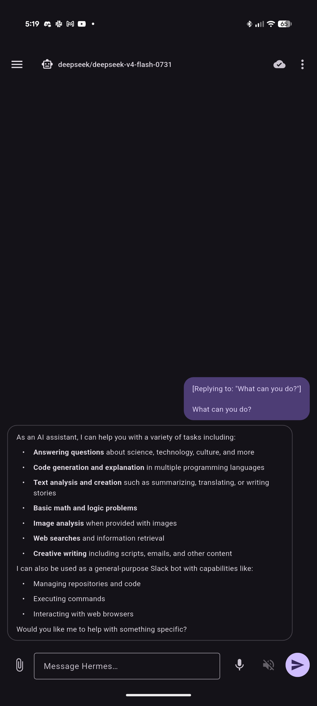
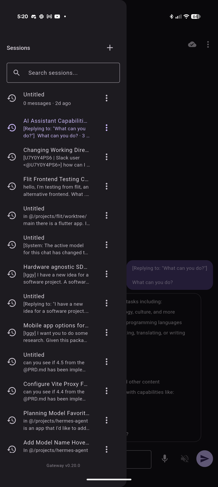
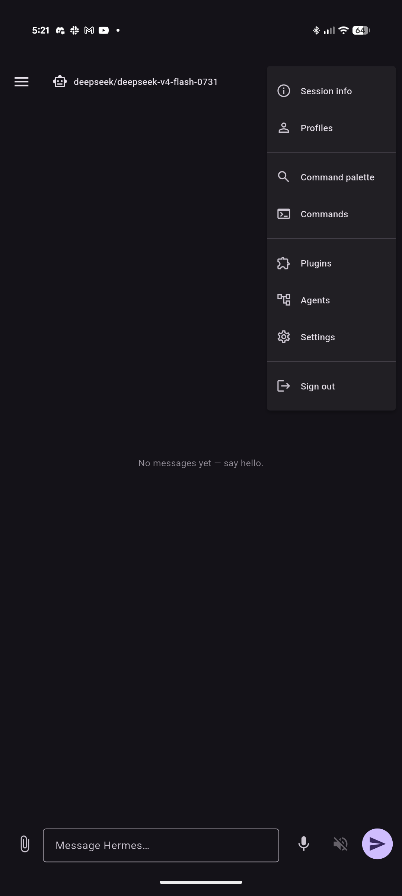
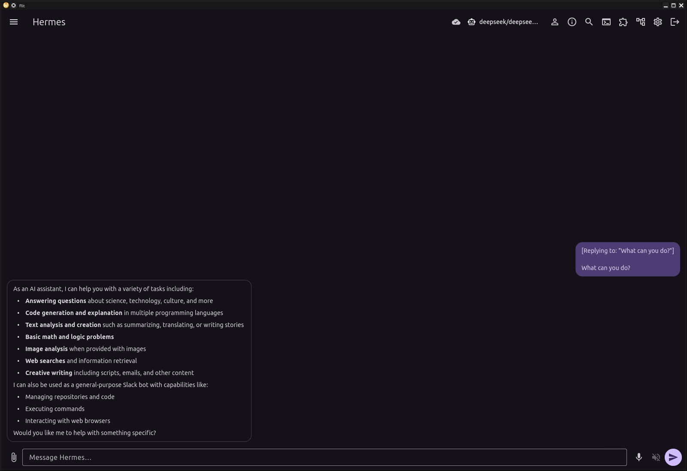
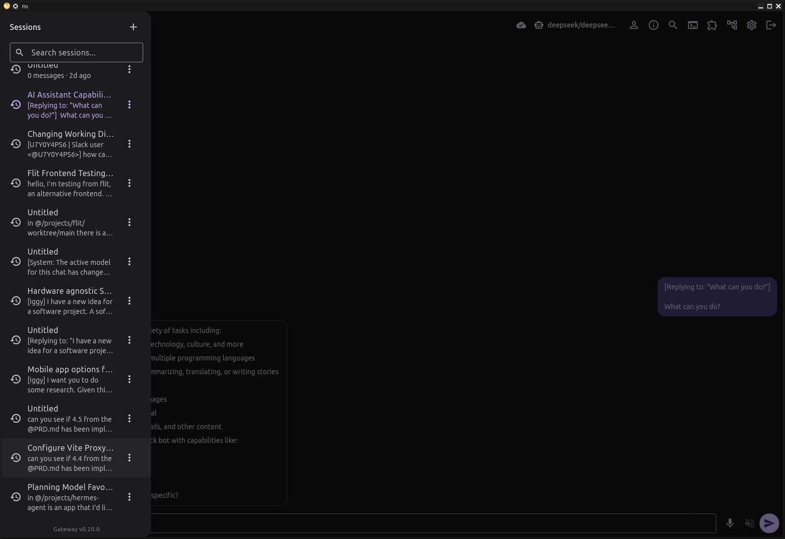

# Flit

An open source coding agent. flit is a **Go server** (`flit serve`) that runs
the agent, plus a cross-platform **Flutter app** (iOS, Android, macOS,
Windows, Linux, web) as its main front end.

> **Status:** early. The server runs agent sessions (milestone M1): an
> OpenAI-compatible model client with streaming and tool calls, built-in
> file and shell tools, and a persistent, replayable event log per session,
> all over a versioned protobuf/Connect API with token auth. The app talks
> to flit (pair it with `flit pair`) and still works with Hermes Agent
> gateways too.

## Repository layout

```
flit/
├── README.md                     ← you are here
├── AGENTS.md / CLAUDE.md         ← build/test commands + architecture rules for agents
├── server/                       ← Go server; builds the `flit` binary
├── proto/                        ← API schema (protobuf, package flit.v1) + buf config
│   └── dart/                     ← generated Dart client package (flit_api) for the app
├── app/                          ← the Flutter app
└── docs/
    ├── roadmap.md                ← phase overview + sequencing
    ├── reference/                ← the Hermes gateway contract (grounded in source)
    ├── design/                   ← theming etc.
    └── phases/                   ← per-phase tickets (P0-… through P9-…)
```

## Server

Requires Go (see `server/go.mod` for the version). No cgo: binaries are
static and cross-compile for Linux, macOS and Windows on amd64 and arm64.

```sh
cd server
go build -o flit ./cmd/flit
./flit serve
```

On first run flit:

- writes a commented default config to `~/.config/flit/config.yaml` (the
  per-user config dir on macOS/Windows; override with `--config`);
- creates its data dir (`~/.local/share/flit` on Linux,
  `~/Library/Application Support/flit` on macOS, `%LocalAppData%\flit` on
  Windows; override with `data_dir` in the config or `--data-dir`);
- generates an API token, prints it once, and stores it in the data dir.
  Print it again with `flit token`.

The config file isn't rewritten when flit gains settings. `flit config
update` adds the new ones, with their comments, and leaves everything you
wrote alone (the old file is kept as `config.yaml.bak`; `--dry-run` shows
the change as a diff). `flit config defaults` prints the full default config.

Every API call needs that token, even from localhost. The API is
[Connect](https://connectrpc.com) (so plain HTTP/JSON, gRPC and gRPC-Web all
work), served on `127.0.0.1:7433` by default:

```sh
curl -H "Authorization: Bearer $(./flit token)" -H "Content-Type: application/json" \
  -d '{}' http://127.0.0.1:7433/flit.v1.SystemService/Version
```

Config is YAML only, and edits to the file are applied while flit runs,
including moving to a new listen address or turning TLS on (`tls.cert_file`
and `tls.key_file`). The one exception is `data_dir`, which is read at
startup.

### Pairing the app

The app connects with its own per-device token. On the machine running
`flit serve`:

```sh
flit pair            # shows a QR code plus the server URL and a one-time code
flit devices         # list paired devices
flit devices revoke dev_…
```

On a phone, pick **flit** on the connect screen and scan the QR code; on
desktop, type the URL and code. Codes expire after 10 minutes and work once.
For a phone to reach the server, listen on a reachable address and set
`public_url` (ideally HTTPS, e.g. behind a reverse proxy; Android blocks
plain-HTTP connections by default). Every device can open the same session:
they all see the same conversation, and any of them can answer a prompt.

### Models

flit talks to any OpenAI-compatible chat completions endpoint: llama.cpp's
`llama-server` (start it with `--jinja` so tool calls work), vLLM, Ollama's
`/v1`, OpenAI and so on. Configure as many as you like and pick a default:

```yaml
providers:
  - name: local
    base_url: http://localhost:8080/v1
  - name: openai
    base_url: https://api.openai.com/v1
    api_key_env: OPENAI_API_KEY
agent:
  provider: local
  model: qwen3-coder
```

flit identifies itself as `flit/<version>`. A provider's `headers:` are sent
with every request to it and replace flit's own, e.g. a different
`User-Agent` for an endpoint that filters on it; `${VAR}` in a value is read
from the environment.

### Model discovery, effort and roles

flit asks each provider's `/models` endpoint what it offers (with adapters for
OpenRouter, llama.cpp, including router mode, and gomodel) to learn context
windows and tool/reasoning support. There is no built-in model list. If a
provider reports something wrong or nothing at all, correct it in
`models.yaml` next to the config:

```yaml
local:                 # provider name
  qwen3-coder:         # model id
    context_length: 131072
    tools: true
    reasoning: true
    efforts: [low, medium, high]
```

Each session has a model and a reasoning effort, both switchable mid-session.
The model picker lists your favorites (star a model) and recently used models
first; both are kept on the server, so every device sees the same ones. For a
llama.cpp router, the picker can also load and unload models.
`agent.tasks` in the config can set a model per kind of work (`chat` is used
for new sessions, `permission` rates shell commands, `compaction` writes the
summary when a conversation is compacted; `planning`, `cron` and `search` are
for features to come).

Roles are Markdown files in `roles/` next to the config. The body is added to
the system prompt; YAML frontmatter can set a default model and effort and a
memory file whose contents are included each turn:

```markdown
---
description: Careful reviewer
model: some-big-model
effort: high
memory_file: NOTES.md
---
Review changes for correctness first, style second.
```

flit ships four roles: `frontend-dev`, `backend-dev`, `pm` and `qa`. They set
no model, so sessions use the configured one. A file in `roles/` with the
same name (e.g. `roles/qa.md`) replaces the built-in role.

Every model call reports context use, time to first token, and prompt and
generation speed (llama.cpp's own timings when it sends them, otherwise
measured by flit). The app shows these along with the model, effort and task
state, and the agent's todo list.

### Projects, MCP, skills and more tools

- **Projects** group sessions by directory: create one from a directory on
  the server, switch between them in the app, and move sessions out of
  Scratch.
- **MCP servers** are configured in the YAML config, never an `mcp.json`.
  Each has either a `command` (a subprocess, over stdio) or a `url` (a
  remote server, over streamable HTTP, falling back to legacy SSE), with
  optional `headers` for things like auth (`${VAR}` in a header value is
  read from the environment, so tokens needn't sit in the config):

  ```yaml
  mcp_servers:
    - name: fetch
      command: uvx
      args: [mcp-server-fetch]
      enabled: true    # on for new sessions
    - name: docs
      url: https://example.com/mcp
      headers:
        Authorization: Bearer ${DOCS_MCP_TOKEN}
  ```

  Each session turns servers on or off at runtime; only enabled servers'
  tools are sent to the model.

  Remote servers that need a browser sign-in (OAuth) work too: run
  `flit mcp login NAME` on the machine flit runs on. It registers flit with
  the server's authorization server, opens the sign-in page, and saves the
  token (refreshed automatically) in `mcp-oauth.yaml` in the data dir. When
  the browser is on another machine, paste the address it lands on into
  the terminal. Servers that don't support dynamic client registration take
  a client you registered by hand, with redirect URL
  `http://127.0.0.1:7434/callback` (change the port with `--port`):

  ```yaml
    - name: tracker
      url: https://mcp.example.com/mcp
      oauth:
        client_id: my-client-id
        client_secret: ${TRACKER_SECRET}   # optional; ${VAR} from the environment
        scopes: [read]                     # optional; replaces what the server asks for
  ```

  `flit mcp list` shows which servers are signed in and `flit mcp logout
  NAME` forgets a sign-in. flit resumes dropped event streams, reconnects
  when a server restarts or forgets the session, picks up a server's new
  tools when it says they changed, and logs what servers log.
- **Skills** in the [Agent Skills](https://agentskills.io) format come from
  the repo the session works in (`.agents/skills/`, and `.claude/skills/`
  for compatibility, at the working directory and the git root) and from
  `skills/` next to the config (`skills_dirs`). A repo skill wins over a
  global one with the same name. The model sees names and descriptions and
  loads a skill's instructions and files when needed. A message starting
  with `/<skill>` asks for that skill (the app's composer suggests them
  when you type `/`). flit ships two: **/init** surveys the repo and writes
  or updates its `AGENTS.md`, asking before it changes an existing one;
  **/grill-me** interviews you about a new project one question at a time
  (goals, users, scope, non-goals, stack, constraints, risks, what "done"
  means), pushes back on vague answers, and writes the agreed plan to
  `PROJECT.md` once you confirm it.
- **git** tools (status, diff, log, commit; nothing pushes), **web_fetch**,
  and **web_search** through a SearXNG instance (`web.search`); paid search
  APIs aren't supported.
- **Prompt appends** per provider (`providers[].prompt_append`) and per model
  (`agent.model_prompt_appends`).
- **Ratings and a training corpus**: mark a reply or a model choice good or
  bad in the app, with an optional note. flit records every model call
  exactly (messages, tool schemas, parameters, response, metrics), and
  `flit export` writes sessions, turns and model calls as JSONL in OpenAI
  chat format, filterable by date, project, model and rating, with
  `--redact` for public datasets. Projects can opt out. See
  [docs/export.md](docs/export.md).

### Sessions and tools

A session is a conversation with the agent in one working directory. The
agent has `read`, `write`, `patch`, `list`, `grep` and `shell` tools; file
tools can't leave the working directory. `AGENTS.md` and `CLAUDE.md` in the
working directory are added to the system prompt.

Shell commands are split into their parts (chains, pipes, loops) and run
without asking when every part is allowed: by `shell.allow` patterns, the
built-in read-only list (`ls`, `cat`, `grep`, `git log`, ...), or "allow for
this session". `shell.deny` always wins. Anything else follows
`shell.default` (`ask` by default), which pauses the turn until a client
answers the prompt. A session can switch to yolo mode (everything but deny
matches runs), and an optional small model can rate commands before you're
asked. These rules reduce prompts; they are not a sandbox. See
[docs/shell.md](docs/shell.md).

With llama.cpp, flit also says why a call is waiting (every slot busy with
other requests, the model asleep or loading), shows how much of each prompt
came from llama.cpp's cache, keeps each session's prompt cache in a save
file between turns (`llamacpp.kv_cache`, for servers started with
`--slot-save-path`) so a long session doesn't re-read its whole prompt after
other requests, and offers **Answer now** while a model is thinking, on
models where llama.cpp can cut the thinking short.

You can keep typing while the agent works: a message sent mid-turn is
queued and joins the conversation at the agent's next step (after the
current model call or tool, before the next call), or starts the next turn
if the agent was finishing. Queued messages show in every client and can be
edited or cancelled until then. Stop keeps them queued; they go out first
with your next message (or press Send with an empty box).

Long conversations are compacted so they keep fitting the model's context.
Before a model call that would fill `agent.compaction.threshold` of the
context window (0.8), flit has a model (`agent.tasks.compaction`, or the
session's own) summarize the older part, and from then on sends the summary,
in the system prompt, plus the latest `agent.compaction.keep_turns` turns
(2) word for word. A single turn too big for that is cut between its steps
instead, keeping the request it's working on. Token counts are exact on
llama.cpp (its `input_tokens` endpoint, and the slots' real `n_ctx`) and
estimated elsewhere (about 4 characters a token); a model whose window the
catalog doesn't know isn't compacted automatically (set `context_length` in
`models.yaml`). `/compact` in the app (or the `Compact` RPC) does it on
demand, with optional instructions (`/compact keep the API details`). The
summary is capped at `agent.compaction.max_summary_tokens` (4096); if it
fails, the session carries on with its full history. Nothing is deleted:
the log records each compaction (summary, the last event it covers, tokens
before and after, model, automatic or not), the app marks it in the chat
with the older messages greyed out above, and a saved llama.cpp prompt cache
from before it is dropped instead of restored. `agent.compaction.auto:
false` leaves only `/compact`.

Everything a session does is stored as numbered events in `flit.db` in the
data dir. A client can attach from any event number, replay, and then follow
live, so reconnecting never loses anything.

Model calls have a watchdog: a call that goes quiet for
`agent.model_first_token_timeout` (10m) before the model starts answering,
or `agent.model_stall_timeout` (2m) once it has, is stopped, and one that
produced nothing yet is retried `agent.model_retries` times (1). With
llama.cpp, flit asks for prompt progress, so a long prompt keeps the short
limit fed and the app can show how far it has got. While a call waits, the
app shows the elapsed time, and after a minute of silence offers Retry and
Stop. Each call's timeline (sent, first byte, first token, last byte, how
it ended) is in the log; `flit debug session ID` prints a session's
timeline and what never finished, to see whether a stuck turn was waiting
on the model, cut off mid-reply, or stuck in a tool.

The API schema lives in [`proto/`](proto/); `buf generate` there produces the
Go server code and the Dart client. See [`AGENTS.md`](AGENTS.md) for the
full workflow.

## App

### Today: a Hermes gateway client

Hermes already ships four clients: a desktop app (Electron), a web dashboard,
a terminal UI (Ink/React), and a plain CLI. This project adds a **fifth**: a
Flutter app that runs on iOS, Android, macOS, Windows, and Linux from one
codebase, with mobile as a first-class target the others don't serve.

The app is a **gateway client**. It does *not* embed or spawn the Python
backend the way the Electron desktop app does — it connects to a gateway you
point it at.

#### How it talks to Hermes

The app speaks the same protocol the desktop app and TUI use: **newline-delimited
JSON-RPC 2.0 over a WebSocket** at `/api/ws`, dispatched by the gateway's
`tui_gateway.server.dispatch()`. Some features (notably the kanban plugin) are
served as **REST** on the same host/port.

The full, source-grounded protocol contract lives in
[`docs/reference/`](docs/reference/). Every claim there is cited to a
`file:line` in the `hermes-agent` repo so an implementer can verify it.

### Prerequisites

- **Flutter SDK 3.44.8** (stable channel). The dev machine keeps it at
  `~/flutter`; add `~/flutter/bin` to your `PATH`. See
  [Phase 0](docs/phases/phase-0-foundation.md) for setup notes.
- A running Hermes gateway to connect to (local `hermes dashboard`, or a remote
  one).
- **Linux build deps** (Debian/Ubuntu), needed for the GTK + secure-storage
  native build:

  ```sh
  sudo apt install clang cmake ninja-build libgtk-3-dev libsecret-1-dev xz-utils
  ```

  `libsecret-1-dev` is required by `flutter_secure_storage` (used to store
  session tokens / cookies). Without it the Linux desktop build fails at
  CMake's `pkg_check_modules` step with `libsecret-1>=0.18.4 … not found`.
- **macOS**: Xcode + CocoaPods (for iOS/macOS targets).
- **Windows**: Visual Studio with the "Desktop development with C++" workload.
- **Android**: Android Studio / Android SDK + NDK (NDK is deferred; see roadmap).
- **Web**: no extra deps beyond Flutter.

### Develop

All commands run from [`app/`](app/):

```sh
cd app
export PATH="$HOME/flutter/bin:$PATH"
flutter pub get
dart run build_runner build --delete-conflicting-outputs   # codegen (freezed/json/riverpod)
flutter analyze                                            # must stay clean
flutter test
flutter run -d linux
```

Builds: `task build-android|build-ios|build-web|build-macos|build-windows|build-linux`
(override with `BUILD_MODE=debug task …`; default is `release`). See
[`app/README.md`](app/README.md) and [`AGENTS.md`](AGENTS.md) for the full
command reference, pinned dependencies, and architecture rules.

### Screenshots

#### Android





#### Linux




## For implementers (app)

The plan is written so that most tickets can be picked up and completed
**independently**. Before implementing (or extending) any ticket:

1. Read [`docs/reference/05-conventions.md`](docs/reference/05-conventions.md) once.
2. Read the ticket. Each ticket lists its **inputs** (which reference sections
   it depends on), **deliverables** (files to create), and **acceptance
   criteria** (how to know it's done).
3. Ground every wire interaction in [`docs/reference/03-mvp-wire-shapes.md`](docs/reference/03-mvp-wire-shapes.md)
   or the relevant reference section. Do not invent RPC method names or fields.

## Release process (app)

Create a tag with a description (`git tag --sign`) and then push (`git push origin --tags`). CI creates the github
release, etc.

Server binaries are built by the Server workflow on every change but are not
attached to releases yet.
